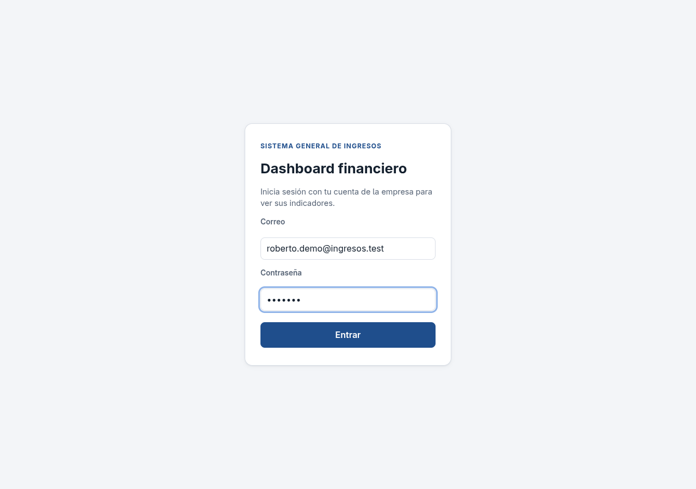
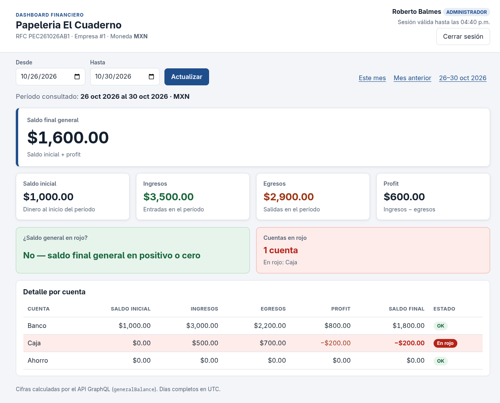
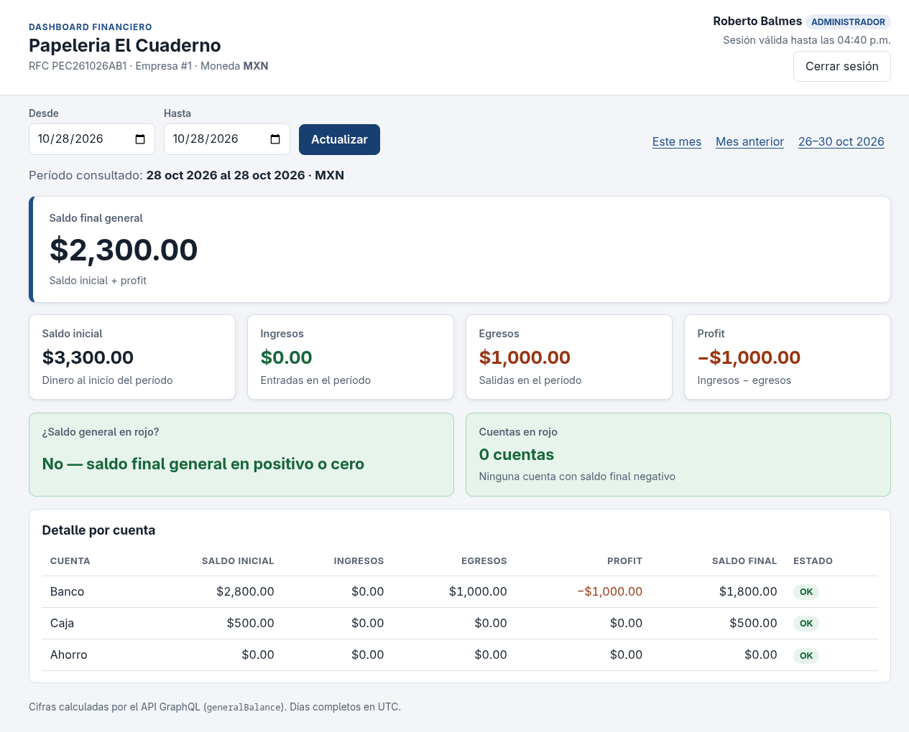
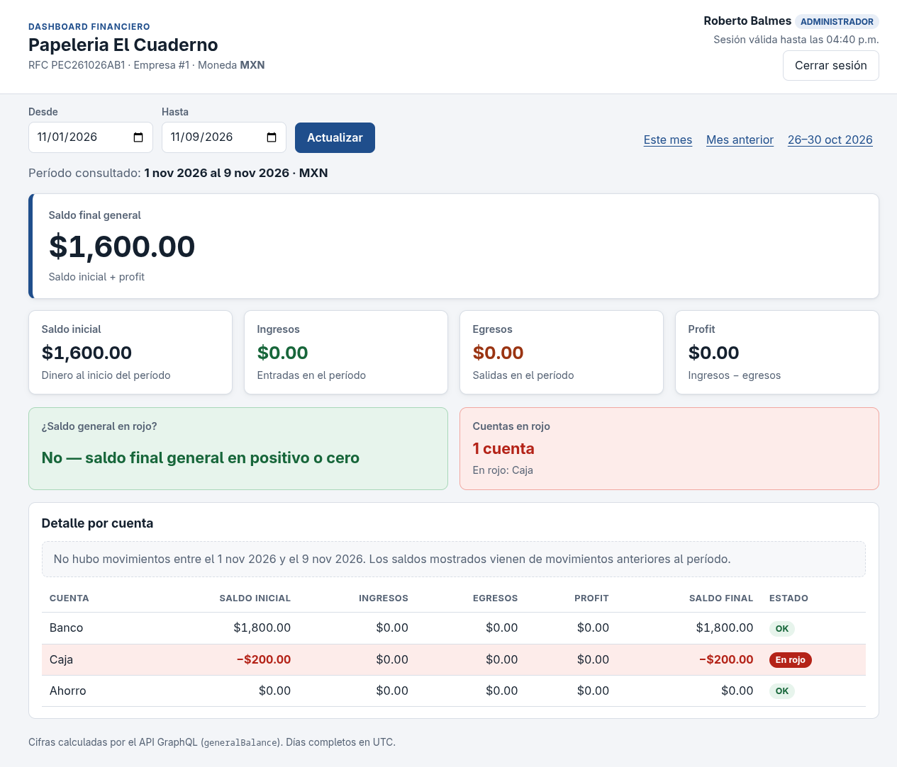
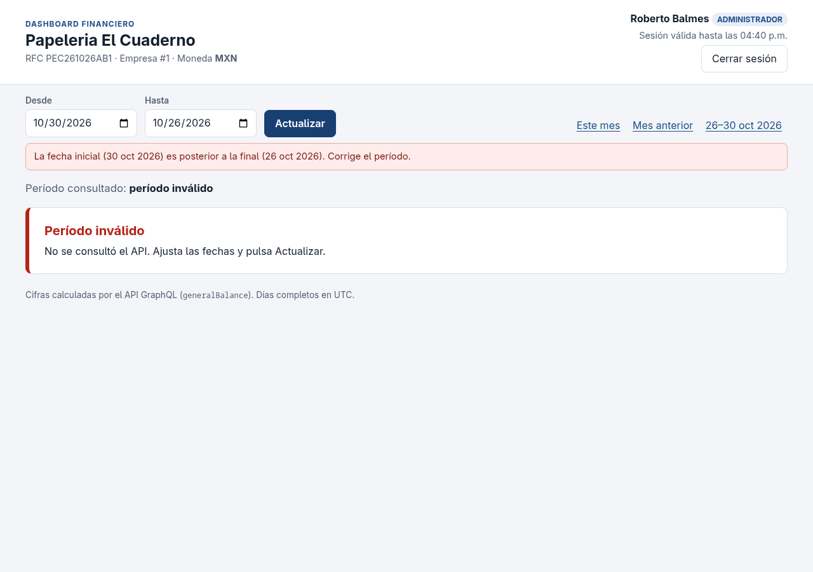
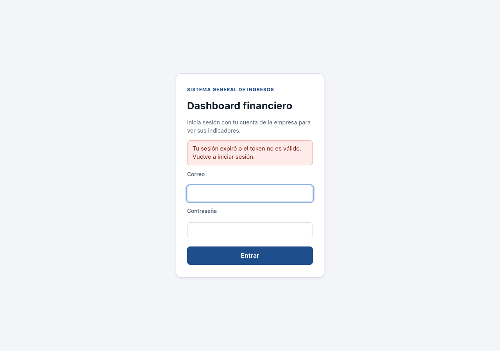
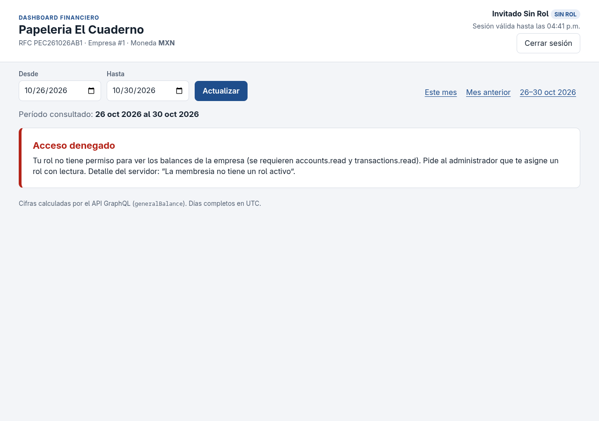
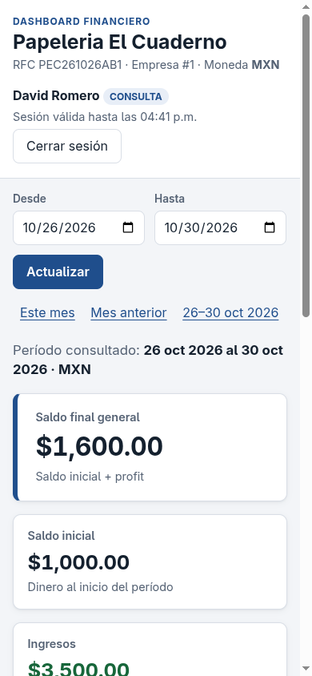

# Evidencias · Unidad III · Actividad 1 · Dashboard financiero

Integrantes: Roberto Balmes Solís, David Romero

Capturas tomadas el 9 de noviembre de 2026 con el backend en Docker (`docker compose up --build`), los datos de
`python pruebas/u3_actividad1_datos.py` y el dashboard en http://localhost:8000/dashboard/.

## Tabla de referencia (26 al 30 de octubre de 2026)

| Indicador | Esperado (actividad) | Dashboard | GraphiQL (`generalBalance`) |
|---|---|---|---|
| Saldo inicial | 1,000.00 | $1,000.00 | `"1000.00"` |
| Ingresos | 3,500.00 | $3,500.00 | `"3500.00"` |
| Egresos | 2,900.00 | $2,900.00 | `"2900.00"` |
| Profit | 600.00 | $600.00 | `"600.00"` |
| Saldo final | 1,600.00 | $1,600.00 | `"1600.00"` |
| General en rojo | No | No | `isInRed: false` |
| Cuentas en rojo | 1 (Caja) | 1 cuenta · En rojo: Caja | `accountsInRed: 1` |

## 1. Login

Pantalla de inicio de sesión con el usuario administrador. Al pulsar **Entrar** se llama `login` y el token se
guarda en `sessionStorage`.

## 2. Indicadores generales y detalle por cuenta (26–30 oct 2026)

Encabezado con empresa, MXN, usuario y rol; período visible; saldo final como número principal; las cuatro
tarjetas; el general **no** está en rojo mientras **Caja** sí (−$200.00). La tabla coincide con
`generalBalance.accounts`: Banco 1,800.00, Caja −200.00, Ahorro 0.00.

## 3. Cambio de fechas (solo el 28 de octubre)

Al cambiar a 28–28 los números se vuelven a consultar: Banco tiene profit de −1,000.00 (en naranja) pero su saldo
final sigue en 1,800.00, así que no aparece en rojo. Un profit negativo no se confunde con números rojos.

## 4. Estado vacío (período sin movimientos)

Del 1 al 9 de noviembre no hay movimientos: la pantalla lo dice y los saldos vienen de movimientos anteriores.

## 5. Error: fechas invertidas

`fromDate` (30 oct) posterior a `toDate` (26 oct): el dashboard **no** llama al API y muestra el aviso.

## 6. Error: token inválido

Se alteró la firma del token guardado y se recargó la página. El backend respondió `El token no es valido` y el
dashboard regresó al login con un mensaje entendible.

## 7. Error: usuario sin permiso de lectura

`invitado.demo@ingresos.test` tiene membresía pero ningún rol. El backend responde
`La membresia no tiene un rol activo` y el dashboard muestra **Acceso denegado** sin cifras en cero.

## 8. Rol CONSULTA en pantalla de celular

David Romero (CONSULTA, con `accounts.read` y `transactions.read`) ve los mismos totales. A 390 px de ancho la
página no tiene scroll horizontal.

